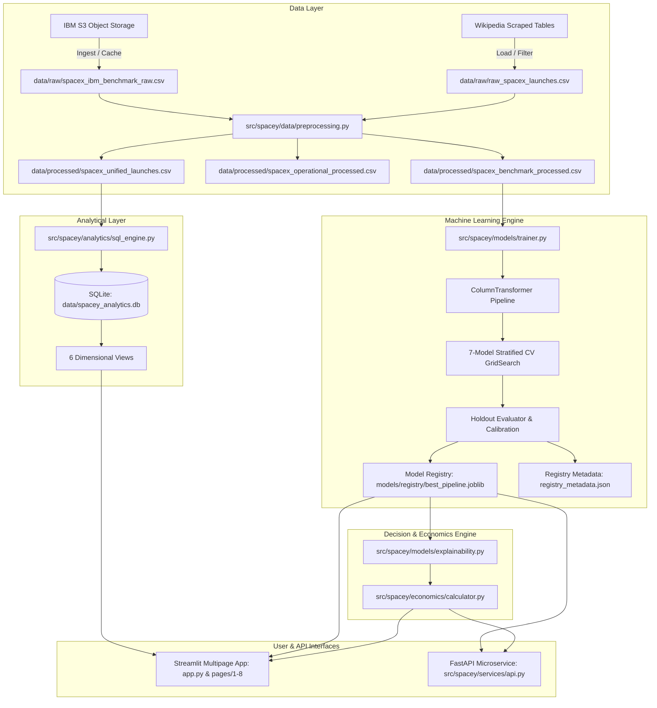

# SpaceY Intelligence — Technical Architecture & Component Design

## 1. High-Level Architecture Overview

The SpaceY Intelligence platform implements a clean, modular Python architecture separating ingestion, preprocessing, analytical querying, machine learning pipelines, commercial economics, UI presentation, and REST APIs.



---

## 2. Directory Layout & Module Responsibilities

```text
spacey_capstone/
├── app.py                         # Primary Streamlit application entry point
├── pages/                         # Streamlit multipage application views
│   ├── 1_Executive_Overview.py    # Strategic KPIs, macro trends & fleet evolution
│   ├── 2_Launch_Explorer.py       # Multi-parameter filtering & data table export
│   ├── 3_Geospatial_Intelligence.py# Folium map with verified launch site coordinates
│   ├── 4_Predictive_Lab.py        # Scenario simulator, calibrated probability & attribution
│   ├── 5_Model_Intelligence.py     # 7-model leaderboard, ROC curves, calibration & importance
│   ├── 6_Mission_Economics.py     # Commercial bidding, expected costs, margin & break-even
│   ├── 7_Data_Quality.py          # Automated schema validation & provenance fingerprinting
│   └── 8_Technical_Documentation.py# Engineering documentation & interview guide
├── src/
│   └── spacey/
│       ├── config.py              # Centralized paths, site coordinates & constants
│       ├── logging_config.py      # Structured console logging
│       ├── data/
│       │   ├── feature_schema.py  # Pydantic input contracts & feature definitions
│       │   ├── validation.py      # Schema checks & DataQualityReport
│       │   ├── preprocessing.py   # Regex kilogram extraction, footnote cleaner & site mapper
│       │   ├── ingestion.py       # S3 fetch, Wikipedia loader & SHA-256 fingerprinting
│       │   └── loader.py          # Primary data access service & caching
│       ├── analytics/
│       │   └── sql_engine.py      # SQLite database manager & 6 dimensional views
│       ├── models/
│       │   ├── pipeline.py        # ColumnTransformer & Pipeline builder
│       │   ├── evaluator.py       # Accuracy, ROC-AUC, PR-AUC, Brier score & latency
│       │   ├── explainability.py  # Permutation importance & local scenario attribution
│       │   ├── registry.py        # Deterministic pipeline serialization & metadata
│       │   └── trainer.py         # Multi-model grid search & model selection
│       ├── economics/
│       │   └── calculator.py      # Commercial launch bidding, break-even & sensitivity
│       ├── services/
│       │   └── api.py             # Typed FastAPI microservice endpoints
│       └── ui/
│           ├── theme.py           # Aerospace dark-navy theme & badge components
│           └── charts.py          # Interactive Plotly visual components
├── data/
│   ├── raw/                       # Cached raw data layers
│   ├── processed/                 # Validated benchmark, operational, & unified CSVs
│   ├── raw_spacex_launches.csv    # Original raw scraped Wikipedia archive
│   ├── cleaned_spacex_launches.csv# Original legacy cleaned dataset
│   └── spacey_analytics.db        # SQLite analytical database
├── models/
│   └── registry/                  # Active production pipeline & registry_metadata.json
├── notebooks/                     # Preserved legacy exploratory notebooks (1-4)
├── scripts/
│   ├── prepare_data.py            # End-to-end data pipeline runner
│   └── train_model.py             # Multi-model training and benchmarking runner
├── tests/                         # Pytest test suite (23 unit & integration tests)
├── docs/                          # Comprehensive technical documentation suite
├── .github/workflows/ci.yml       # GitHub Actions automated test & lint quality gates
├── Dockerfile                     # Production container definition
├── docker-compose.yml             # Streamlit + FastAPI multi-service composition
├── requirements.txt               # Pinned Python package dependencies
├── pyproject.toml                 # Packaging & pytest configuration
└── README.md                      # Presentation-ready platform overview
```
